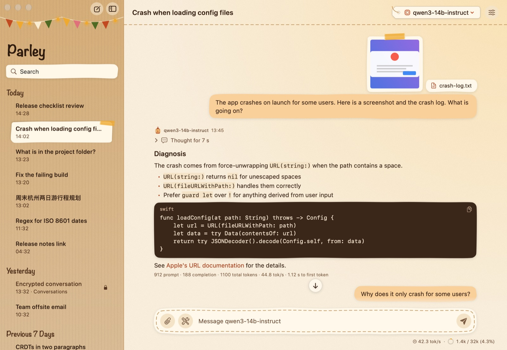
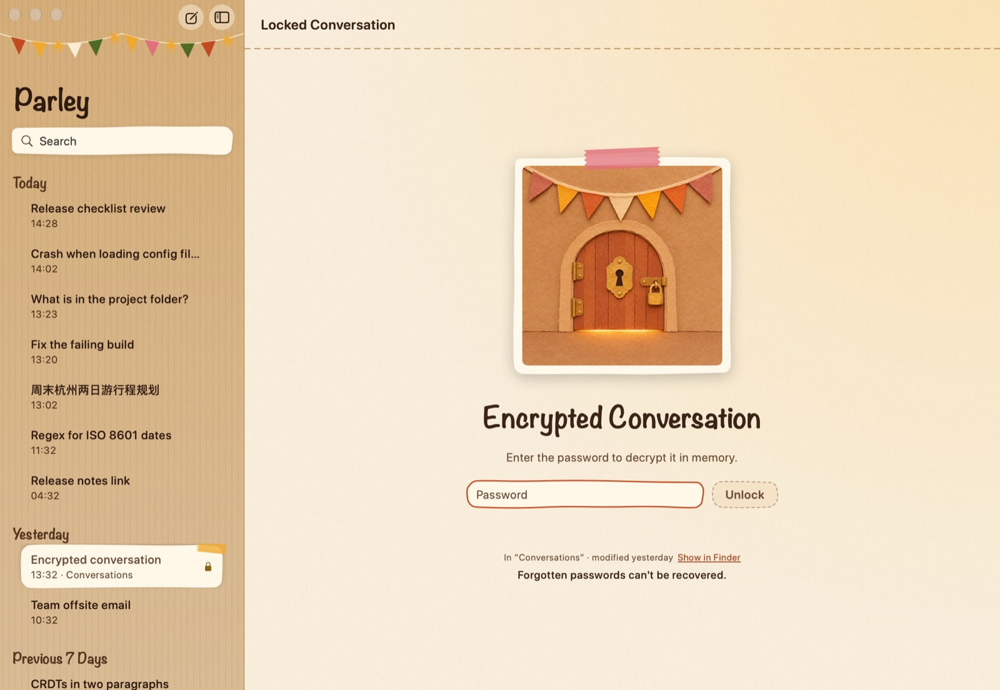
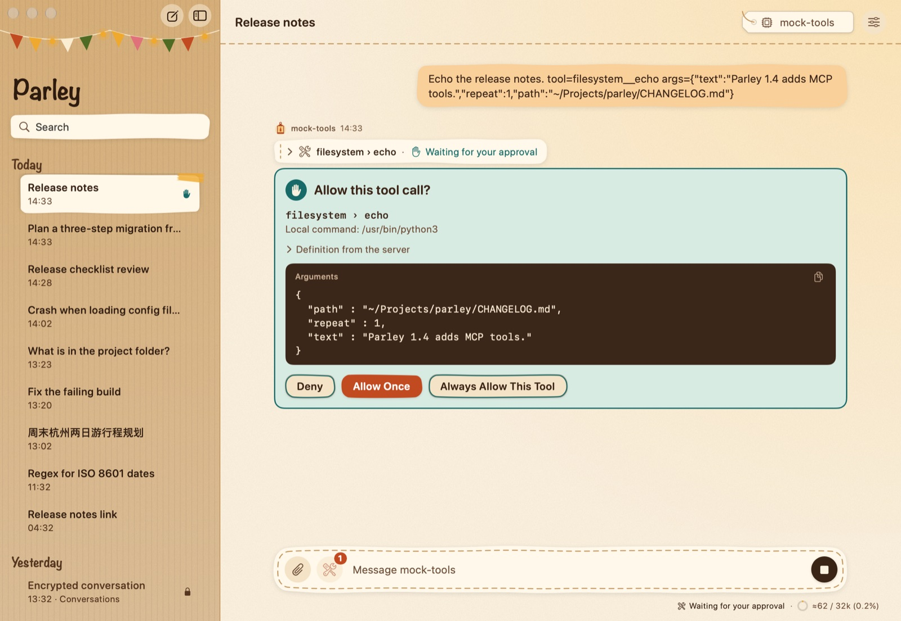
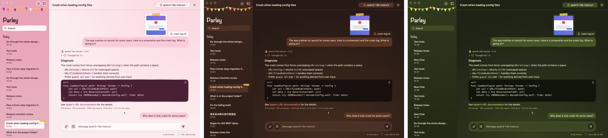

<h1 align="center">Parley</h1>

A cosy, private chat app for macOS that talks to the AI models you choose, 
on your own computer or online.

<b>English</b> · <a href="README.zh-CN.md">简体中文</a>

<a href="https://github.com/yxengram/Parley/releases/latest"><b>Download for Mac</b></a> ·
<a href="https://yxengram.github.io/Parley/">Parley Reader (open chats in any browser)</a>

## What Parley does

**Chat with almost any model.** Parley works with any service that speaks the common
"OpenAI-compatible" language: models running on your own Mac or home server (LM Studio, Ollama,
llama.cpp, vLLM and others) and online services such as OpenAI or OpenRouter. Add as many
servers as you like and switch models from the top of the window.

**Your data stays yours.** Parley talks only to the servers you set up. There is no account, no
tracking and no analytics. API keys are kept in the macOS Keychain, and every conversation is a
plain file in a folder you choose.

**Lock a conversation with a password.** Any conversation can be encrypted. It stays unreadable
on disk until you unlock it, and it locks again with one click. Forgotten passwords can't be
recovered, so keep them somewhere safe.

**Everything you expect from a good chat app**
- Attach pictures and text files by dragging, pasting or clicking the paper clip.
- See the model's "thinking" in a fold-out section, and choose how hard it should think, or turn
  thinking off.
- Hover over a message to copy it, edit and resend, regenerate a reply, roll back, or branch off
  a new conversation from that point.
- Code blocks, tables, lists and links are formatted nicely. Links always ask before opening.
- A small strip under the message box shows how fast the model is replying and how full its
  memory (context) is.

**Let the model use tools, safely.** Parley can give a model tools: a clock, a calculator,
reading files in one folder you pick, and reading web pages. You can also connect "MCP" tool
servers, the same kind used by other AI apps. Every tool is off until you turn it on, and
anything that touches your files or the web asks you first, showing exactly what it wants to do.

**Three hand-made looks.** Pick a skin in Settings: *Cardboard Fort* (kraft paper and lantern
light), *Pillow Fort* (pink quilts and cushions) or *Treehouse* (leaves and fireflies). Each one
has a light and a dark version that follows your Mac's appearance.

**English and Chinese.** Parley uses Simplified Chinese when your Mac's main language is
Chinese, and English otherwise.

## Parley Reader: your chats on any device

[Parley Reader](https://yxengram.github.io/Parley/) is a single web page that opens Parley
conversation files, including encrypted ones (it asks for the password), and shows them the way
Parley does. It runs entirely in your browser: nothing is uploaded anywhere.

- **On a Mac or PC:** open the link, click **Open…** and pick a conversation file (`.json`), or
  drag files onto the page. You can also download `ParleyReader.html` from the
  [release page](https://github.com/yxengram/Parley/releases/latest) and use it offline.
- **On an iPhone or iPad:** put the conversation file somewhere the Files app can reach (for
  example iCloud Drive, or AirDrop it to yourself). Open the link in Safari, tap **Open…** and
  choose the file. Tip: tap Share → **Add to Home Screen** to keep the Reader one tap away.

To find a conversation's file, right-click it in Parley's sidebar and choose
**Reveal in Finder**.

## Install

1. Download `Parley-<version>.zip` from the
   [latest release](https://github.com/yxengram/Parley/releases/latest) and double-click it.
2. Drag **Parley** into your **Applications** folder.
3. Open Parley. The first time, macOS will say it can't check the app for malicious software,
   because Parley is a free project that isn't registered with Apple. To open it anyway:
   - Click **Done** (or **OK**), then open **System Settings → Privacy & Security**, scroll down
     and click **Open Anyway** next to the message about Parley. Confirm once more, and macOS
     will remember your choice.
   - Or, in Terminal: `xattr -dr com.apple.quarantine /Applications/Parley.app`

Requires macOS 14 Sonoma or later, on Apple silicon or Intel Macs.

## Getting started

1. Open **Settings → Providers** and add a server. For a model on your own Mac, LM Studio's
   address is usually `http://localhost:1234/v1`; for OpenAI it's `https://api.openai.com/v1`
   with your API key.
2. Click **New Chat**, choose a model at the top of the window, and start typing.
3. Optional: turn on tools in **Settings → Built-in Tools** or add tool servers in
   **Settings → MCP**, then pick which ones a conversation may use from the 🛠 button next to the
   message box.

The **Help** menu inside Parley explains every feature in more detail.

## For developers

Parley is written in Swift and SwiftUI with no third-party dependencies. Build it with
`./build.sh` (Xcode Command Line Tools are enough) and run the tests with `swift test`.
Technical notes (in Chinese) are in [docs/TECHNICAL.zh-CN.md](docs/TECHNICAL.zh-CN.md), and the
design and module contracts are in [DESIGN.md](DESIGN.md). The Reader's source is in
[Reader/](Reader/).
