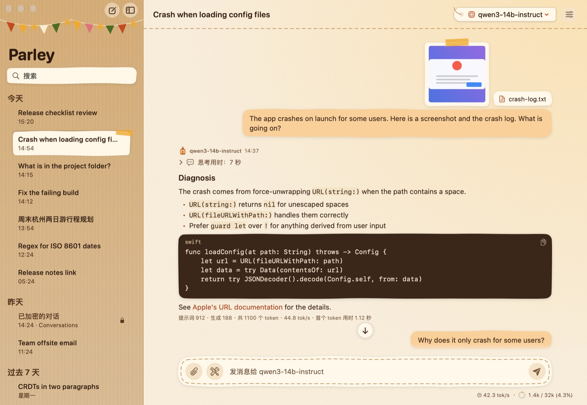
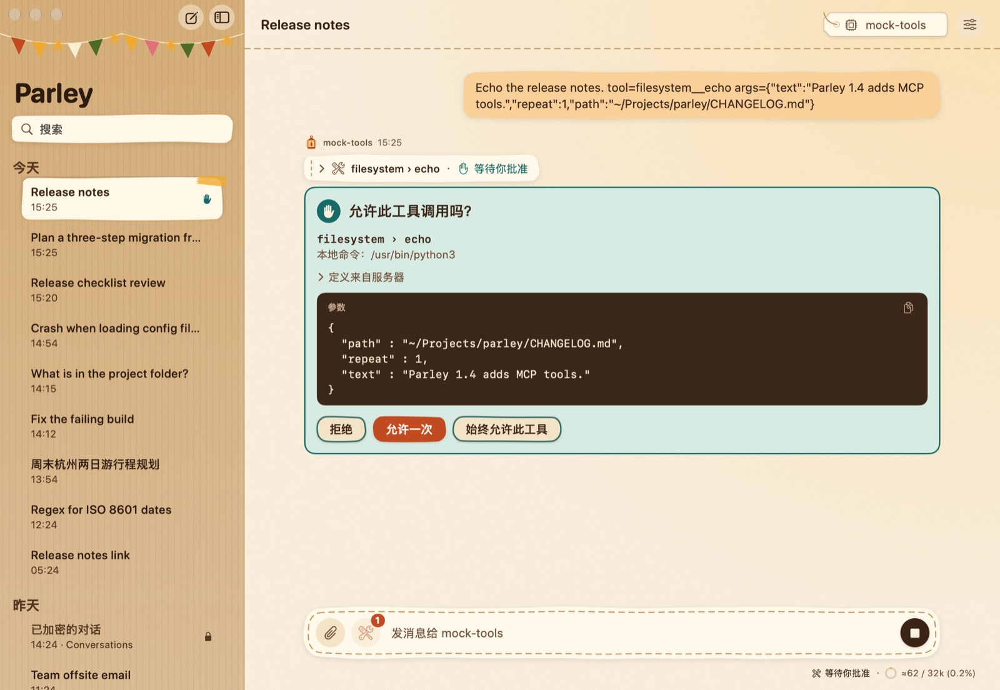
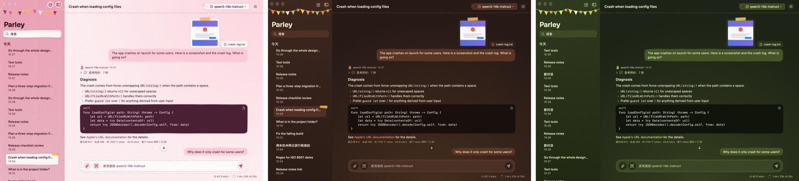

<h1 align="center">Parley</h1>

一个温馨、注重隐私的 macOS 聊天应用， 
连接你自己选择的 AI 模型，本机的、线上的都可以。

<a href="README.md">English</a> · <b>简体中文</b>

<a href="https://github.com/yxengram/Parley/releases/latest"><b>下载 Mac 版</b></a> ·
<a href="https://yxengram.github.io/Parley/">Parley Reader（在任何浏览器里查看对话）</a>

## Parley 能做什么

**几乎能和任何模型聊天。** 只要服务支持通用的“OpenAI 兼容”接口，Parley 就能用：既可以是运行在你自己 Mac
或家里服务器上的模型（LM Studio、Ollama、llama.cpp、vLLM 等），也可以是 OpenAI、OpenRouter
这样的在线服务。服务器可以添加任意多个，在窗口顶部就能切换模型。

**你的数据只属于你。** Parley 只和你设置的服务器通信。不需要注册账号，没有追踪，也没有统计分析。API key
保存在 macOS 钥匙串里，每个对话都是你所选文件夹里的一个普通文件。

**用密码锁住对话。** 任何对话都可以加密。解锁之前，它在磁盘上无法读取；点一下就能重新锁上。忘记的密码无法找回，请妥善保管。

**好用的聊天应用该有的，它都有**
- 拖入、粘贴或点回形针，就能附上图片和文本文件。
- 模型的“思考”过程折叠显示，可以调整思考的强度，也可以关掉思考。
- 鼠标移到消息上，可以复制、编辑并重新发送、重新生成回复、回退，或者从这里分叉出一个新对话。
- 代码块、表格、列表和链接都有漂亮的排版。打开链接前总会先问你。
- 输入框下方的小状态条显示模型回复的速度，以及它的记忆（上下文）用了多少。

**让模型安全地使用工具。** Parley 可以给模型提供工具：时钟、计算器、读取你指定的一个文件夹里的文件、读取网页。你还可以连接“MCP”工具服务器，也就是其他
AI 应用使用的同一类工具。所有工具在你打开之前都是关闭的；凡是要动你的文件或访问网络的，都会先问你，并清楚列出它要做什么。

**三套手绘风格的皮肤。** 在设置里挑一套：**纸箱堡垒**（牛皮纸与灯笼光）、**枕头堡垒**（粉色被子与靠垫）或**树屋**（树叶与萤火虫）。每套都有日间和夜间两种外观，跟随系统自动切换。

**中文和英文界面。** Parley 跟随“系统设置 → 通用 → 语言与地区”里的首选语言顺序：英文和简体中文哪个排在前面，就显示哪个；两者都不在列表里时显示英文。

## Parley Reader：在任何设备上查看对话

[Parley Reader](https://yxengram.github.io/Parley/) 是一个网页，可以打开 Parley
的对话文件，包括加密的（会请你输入密码），显示效果和 Parley 里一样。它完全在你的浏览器里运行，不会上传任何东西。

- **在 Mac 或电脑上：** 打开链接，点 **打开…** 选择对话文件（`.json`），或者直接把文件拖到页面上。也可以从[发布页面](https://github.com/yxengram/Parley/releases/latest)下载
  `ParleyReader.html`，离线使用。
- **在 iPhone 或 iPad 上：** 先把对话文件放到“文件”App 能找到的地方（例如 iCloud 云盘，或者用隔空投送发给自己）。在 Safari
  里打开链接，点 **打开…** 选择文件。小技巧：点“分享”→“**添加到主屏幕**”，以后一点就能打开 Reader。

想找到某个对话的文件，在 Parley 边栏里右键点它，选择“**在访达中显示**”。

## 安装

1. 从[最新发布](https://github.com/yxengram/Parley/releases/latest)下载 `Parley-<版本号>.zip`，双击解压。
2. 把 **Parley** 拖进“**应用程序**”文件夹。
3. 打开 Parley。第一次打开时，macOS 会提示无法验证它是否包含恶意软件，因为 Parley 是没有在 Apple 登记的免费项目。仍要打开的话：
   - 点“**完成**”（或“好”），然后打开“**系统设置 → 隐私与安全性**”，向下滚动，在关于 Parley
     的提示旁点“**仍要打开**”。再确认一次，macOS 就会记住你的选择。
   - 或者在“终端”里运行：`xattr -dr com.apple.quarantine /Applications/Parley.app`

需要 macOS 14 Sonoma 或更高版本，Apple 芯片和 Intel 芯片的 Mac 都能用。

## 快速上手

1. 打开“**设置 → 提供商**”，添加一个服务器。如果模型在你自己的 Mac 上，LM Studio 的地址通常是
   `http://localhost:1234/v1`；OpenAI 是 `https://api.openai.com/v1`，再填上你的 API key。
2. 点“**新对话**”，在窗口顶部选择模型，然后开始输入。
3. 可选：在“**设置 → 内置工具**”里打开工具，或在“**设置 → MCP**”里添加工具服务器，然后用输入框旁边的 🛠
   按钮选择这个对话可以使用哪些工具。

Parley 里的“**帮助**”菜单对每个功能都有更详细的说明。

## 开发者

Parley 用 Swift 和 SwiftUI 编写，没有任何第三方依赖。用 `./build.sh` 构建（只需 Xcode 命令行工具），用
`swift test` 运行测试。技术细节见 [docs/TECHNICAL.zh-CN.md](docs/TECHNICAL.zh-CN.md)，设计与模块约定见
[DESIGN.md](DESIGN.md)（英文），Reader 的源代码在 [Reader/](Reader/)。
